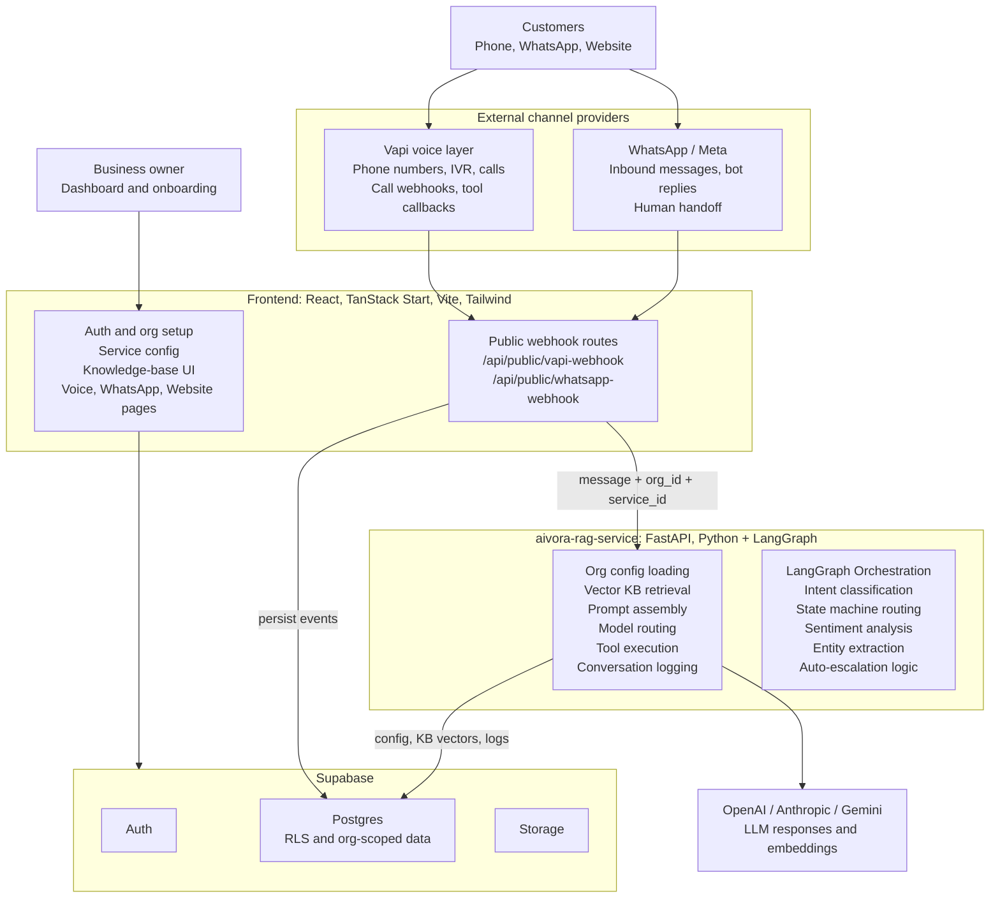
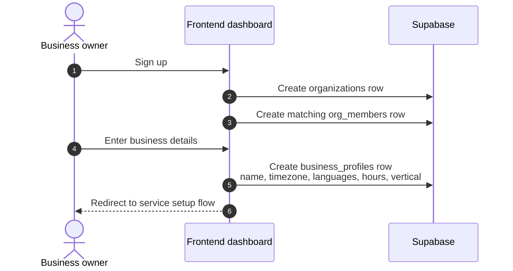
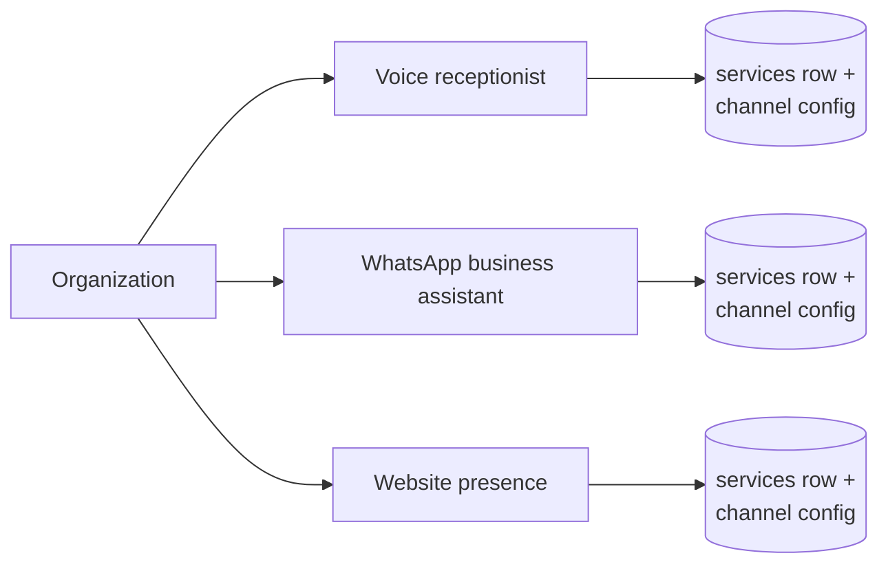
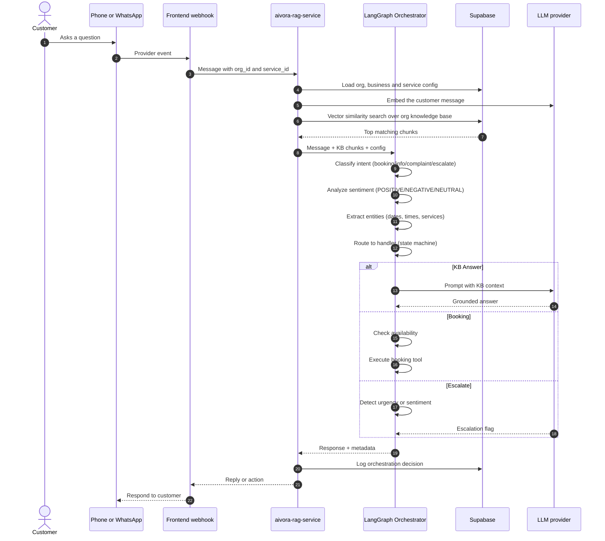
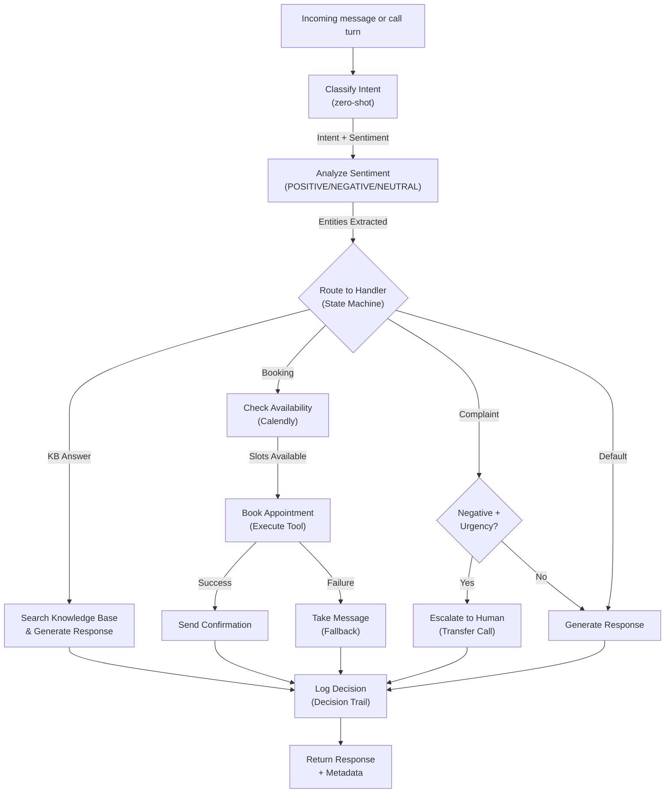
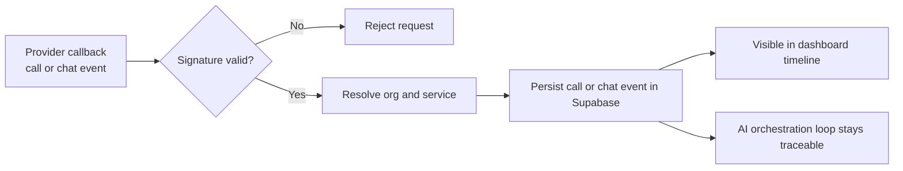
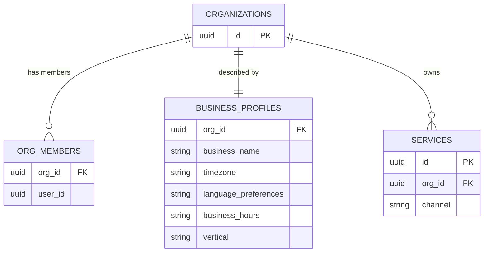
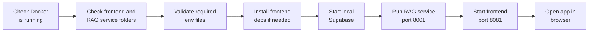
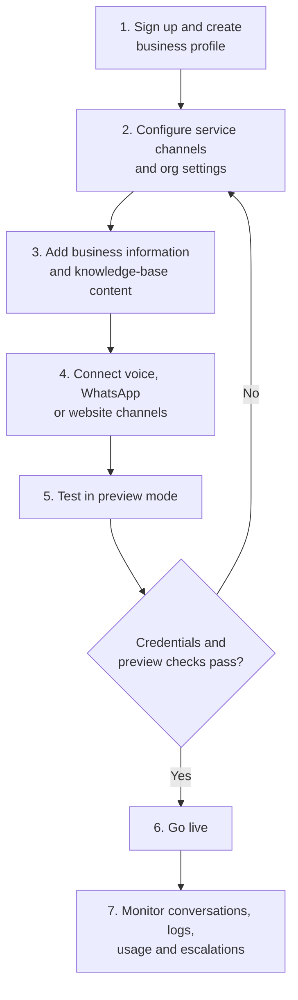
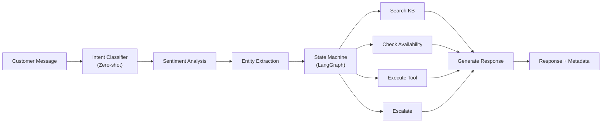

<div align="center">

# Aivora

**AI-powered business automation for local service brands**

Voice receptionist · WhatsApp automation · Website generation · Knowledge-base-backed AI orchestration


</div>

---

## Contents

- [Overview](#overview)
- [Architecture](#architecture)
- [How it works](#how-it-works)
- [Data model](#data-model)
- [Repository structure](#repository-structure)
- [Tech stack](#tech-stack)
- [Getting started](#getting-started)
- [Environment configuration](#environment-configuration)
- [Core business flow](#core-business-flow)
- [Design principles](#design-principles)
- [Documentation](#documentation)

---

## Overview

Aivora is an AI-powered business automation platform for local service brands. It combines a customer dashboard, AI voice receptionist flows, WhatsApp automation, website generation, and a knowledge-base-backed orchestration layer that can answer questions, handle bookings, and escalate to humans when needed.

The repository has three parts: a **frontend app**, a **Python RAG and orchestration service**, and a **local Supabase data layer**. A single startup script wires them together so the full stack runs locally with minimal setup.

Aivora helps a business owner do four things quickly:

| Step | What the owner does |
| --- | --- |
| 1 | Create an organization and onboarding profile |
| 2 | Configure a voice receptionist for phone calls |
| 3 | Connect WhatsApp and website experiences |
| 4 | Power the AI with business context stored in a structured knowledge base |

The platform is meant to feel like an operating system for AI-first customer service, while staying grounded in a simple SaaS flow: **configure business data, connect channels, preview, go live.**

---

## Architecture



| Component | Responsibility |
| --- | --- |
| **Frontend** | Dashboard, onboarding, service configuration, knowledge-base UI, preview flows, and the public webhook endpoints |
| **Supabase** | Multi-tenant auth, Postgres data with RLS, file storage, and vector metadata |
| **Vapi** | Telephony: phone numbers, IVR and calls, call webhooks, tool callbacks |
| **WhatsApp / Meta** | Inbound messages, bot replies, human handoff |
| **aivora-rag-service** | Retrieval, prompt construction, model routing, tool calls, conversation logging |
| **LangGraph Orchestration** | Multi-agent state machine, intent classification, sentiment analysis, entity extraction, smart routing |
| **LLM providers** | Language model responses and embeddings |

---

## How it works

### 1. Organization onboarding



### 2. Service setup

The dashboard manages several service channels for the same organization. Each channel is tied to a `services` row and channel-specific configuration in Supabase.



### 3. Knowledge-base retrieval and multi-agent orchestration

The AI layer uses LangGraph for intelligent decision-making. It reads organization-scoped configuration, classifies intent, performs sentiment analysis, and queries knowledge-base entries before it responds.



### 4. Multi-agent orchestration with LangGraph state machine

The LangGraph orchestration layer decides what action to take based on intent classification and sentiment analysis:



**Graph Nodes:**
- `classify_intent` - Zero-shot classification (8 intent types)
- `search_kb` - Vector search over knowledge base
- `check_availability` - Calendly API call
- `execute_tools` - Booking/messaging tools
- `generate_response` - LLM response generation
- `escalate` - Human handoff with context

**Routing Logic:**
- KB Answer → search_kb → generate_response → END
- Booking → check_availability → execute_tools → escalate/success
- Complaint + negative sentiment → escalate → END
- Default → generate_response → END

### 5. Webhook and event handling

The frontend exposes webhook endpoints that receive provider callbacks:

- `/api/public/vapi-webhook`
- `/api/public/whatsapp-webhook`



---

## Data model

A simplified view of the core entities described above. See [`Project-Documents/05_Backend_Schema.md`](Project-Documents/05_Backend_Schema.md) for the full schema.



---

## Repository structure

```text
Aivora/
├── Frontend/                      React app: dashboard, onboarding, webhooks
│   ├── src/
│   │   ├── components/
│   │   ├── hooks/
│   │   ├── integrations/
│   │   ├── lib/
│   │   ├── routes/
│   │   ├── router.tsx
│   │   └── server.ts
│   ├── public/
│   ├── supabase/
│   ├── .env.local.example
│   ├── package.json
│   ├── vite.config.ts
│   └── README.md
│
├── aivora-rag-service/            FastAPI RAG and orchestration service
│   ├── app/
│   │   ├── api/
│   │   ├── core/
│   │   ├── services/
│   │   ├── tools/
│   │   └── main.py
│   ├── migrations/
│   ├── tests/
│   ├── .env.example
│   ├── requirements.txt
│   ├── Dockerfile
│   └── README.md
│
├── supabase/                      Local config and DB metadata
│
├── Project-Documents/             Product and technical documentation
│   ├── 01_PRD.md
│   ├── 02_TRD.md
│   ├── 03_App_Flow.md
│   ├── 04_UI_UX_Brief.md
│   ├── 05_Backend_Schema.md
│   └── 06_Implementation_Plan.md
│
├── Start-Aivora.ps1               One-command local launcher
├── README.md
├── LOCAL_RUN.md
├── package.json
└── package-lock.json
```

---

## Tech stack

| Layer | Stack | Purpose |
| --- | --- | --- |
| Frontend | React, TanStack Start, Vite, Tailwind | Dashboard, onboarding, preview flows, app shell |
| Data and auth | Supabase Postgres, Auth, Storage | Multi-tenant app data, org management, auth, file upload |
| Voice | Vapi | Telephony orchestration, call WebSockets, assistant events |
| AI / Orchestration | LangGraph, LangChain, FastAPI, Python | Multi-agent state machine, intent classification, sentiment analysis, entity extraction |
| Knowledge Base | FastAPI, Python, pgvector | Knowledge-base search, RAG, prompt construction, model routing |
| Model providers | OpenAI, Anthropic, Gemini | LLM responses and embeddings |
| NLP Models | HuggingFace Transformers | Zero-shot classification, sentiment analysis, entity recognition |
| Integrations | Meta WhatsApp, Twilio, Calendly | Channel integration and business tooling |

---

## Getting started

**Prerequisites:** Docker (for local Supabase), Node.js with npm, Python 3 with pip, and PowerShell for the launcher script.

### Quick start

The easiest way to bring up the full stack is the PowerShell launcher at the repo root:

```powershell
powershell -ExecutionPolicy Bypass -File .\Start-Aivora.ps1
```



| Service | Port |
| --- | --- |
| RAG service | `8001` |
| Frontend dev server | `8081` |

### Manual startup

<details>
<summary>Run each part yourself</summary>

**Frontend**

```bash
cd Frontend
npm install
npm run dev
```

**RAG service**

```bash
cd aivora-rag-service
pip install -r requirements.txt
uvicorn app.main:app --reload --host 0.0.0.0 --port 8001
```

**Local Supabase**

```bash
cd Frontend
npx supabase start
```

</details>

---

## Environment configuration

> [!WARNING]
> Never commit `.env` files or the Supabase service role key. Only the `.example` files belong in git.

### Frontend

Copy `Frontend/.env.local.example` to `Frontend/.env.local` and fill in the required keys.

| Variable | Purpose |
| --- | --- |
| `VITE_SUPABASE_URL` | Supabase project URL |
| `VITE_SUPABASE_PUBLISHABLE_KEY` | Supabase publishable key for the browser client |
| `VAPI_API_KEY` | Vapi API key |
| `ORCHESTRATION_SHARED_SECRET` | Shared secret used between the frontend and the RAG service |
| `RAG_SERVICE_URL` | Where the frontend reaches the RAG service |
| Provider keys | Meta / WhatsApp, Twilio, Calendly and OAuth credentials |

### RAG service

Copy `aivora-rag-service/.env.example` to `aivora-rag-service/.env` and configure:

| Variable | Purpose |
| --- | --- |
| `SUPABASE_URL` | Supabase project URL |
| `SUPABASE_SERVICE_ROLE_KEY` | Server-side Supabase key (keep secret) |
| `OPENAI_API_KEY` | OpenAI provider key |
| `ANTHROPIC_API_KEY` | Anthropic provider key |
| `GEMINI_API_KEY` | Gemini provider key |
| `ORCHESTRATION_SHARED_SECRET` | Must match the frontend value |
| `APP_PORT` | Port the service listens on |
| `KB_TOP_K` | How many knowledge-base chunks to retrieve per query |
| `KB_SCORE_THRESHOLD` | Minimum similarity score for a chunk to be used |

---

## Core business flow



---

## Design principles

| Principle | What it means |
| --- | --- |
| **Multi-tenant by design** | Org-scoped records and service objects keep each business isolated |
| **Knowledge-driven AI** | Business data and knowledge-base entries guide responses instead of a generic bot |
| **Provider abstraction** | New channels plug in without reworking the core conversation loop |
| **Event-first traceability** | Every call and chat interaction is stored so it can be analyzed and resolved |
| **Preview before publish** | Test the assistant before activating it live |

---

## AI Orchestration with LangGraph

Aivora uses **LangGraph** for intelligent multi-agent decision-making. Instead of a simple prompt-response loop, each customer message flows through a state machine that classifies intent, analyzes sentiment, extracts entities, and routes to the appropriate handler.

### Key Features

| Feature | Capability | Benefit |
| --- | --- | --- |
| **Intent Classification** | Detects 8 intent types (booking, info, complaint, escalate, etc.) | Routes customers to the right handler |
| **Sentiment Analysis** | POSITIVE/NEGATIVE/NEUTRAL tracking across conversation | Auto-escalates frustrated customers |
| **Entity Extraction** | Emails, phone numbers, dates, times, services | Auto-fills booking parameters |
| **State Machine Routing** | Explicit decisions at each step | Traceable, debuggable, scalable |
| **Automatic Escalation** | Detects urgency + negative sentiment | Prevents customer frustration loops |
| **Tool Execution** | Graceful fallbacks when operations fail | Booking fails → take message |

### Architecture



### Documentation

For detailed information on LangGraph implementation, see:
- [`README_LANGGRAPH.md`](README_LANGGRAPH.md) - Complete guide
- [`aivora-rag-service/LANGGRAPH_SUMMARY.md`](aivora-rag-service/LANGGRAPH_SUMMARY.md) - Features & benefits
- [`aivora-rag-service/LANGGRAPH_IMPLEMENTATION.md`](aivora-rag-service/LANGGRAPH_IMPLEMENTATION.md) - Technical details
- [`aivora-rag-service/LANGGRAPH_INTEGRATION_EXAMPLE.md`](aivora-rag-service/LANGGRAPH_INTEGRATION_EXAMPLE.md) - Integration guide

---

## Documentation

| Document | Covers |
| --- | --- |
| [`Project-Documents/01_PRD.md`](Project-Documents/01_PRD.md) | Product requirements |
| [`Project-Documents/02_TRD.md`](Project-Documents/02_TRD.md) | Technical requirements |
| [`Project-Documents/03_App_Flow.md`](Project-Documents/03_App_Flow.md) | Application flow |
| [`Project-Documents/04_UI_UX_Brief.md`](Project-Documents/04_UI_UX_Brief.md) | UI and UX brief |
| [`Project-Documents/05_Backend_Schema.md`](Project-Documents/05_Backend_Schema.md) | Backend schema |
| [`Project-Documents/06_Implementation_Plan.md`](Project-Documents/06_Implementation_Plan.md) | Implementation plan |
| [`LOCAL_RUN.md`](LOCAL_RUN.md) | Running the project locally |
| [`README_LANGGRAPH.md`](README_LANGGRAPH.md) | LangGraph orchestration guide |
| [`aivora-rag-service/LANGGRAPH_SUMMARY.md`](aivora-rag-service/LANGGRAPH_SUMMARY.md) | LangGraph features and benefits |
| [`aivora-rag-service/LANGGRAPH_IMPLEMENTATION.md`](aivora-rag-service/LANGGRAPH_IMPLEMENTATION.md) | LangGraph technical implementation |
| [`aivora-rag-service/LANGGRAPH_INTEGRATION_EXAMPLE.md`](aivora-rag-service/LANGGRAPH_INTEGRATION_EXAMPLE.md) | LangGraph integration guide |

---

> **Status:** this repository is still evolving. The architecture is intentionally layered so the product can scale from a local launch to a production SaaS platform without a complete rewrite of the AI orchestration layer.